## operaciones basicas con open cv 
## Alimno cristopher Lopez 1374
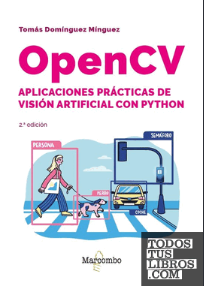
## 1. LECTURA DE LA IMAGEN DESDE LA CARPETA
#### cuendo no puede cargar la imagen 
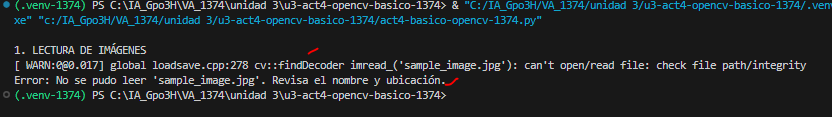
#### cuando puede cargar la imagen 
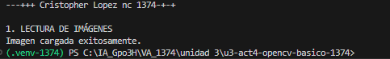
## 2. PROPIEDADES DE LA IMAGEN
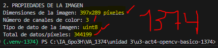

## Mostrando imagen original 
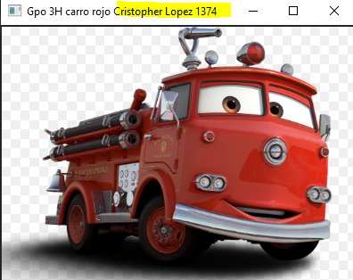
## en la terminal 
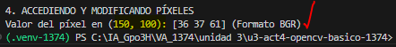
## 4. ACCESO Y MODIFICACIÓN DE PÍXELES INDIVIDUALES
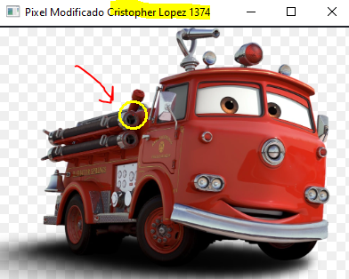
## 5. REGIÓN DE INTERÉS (ROI - REGION OF INTEREST)
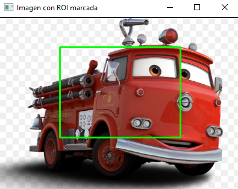
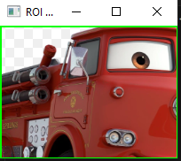

## 6. SEPARACIÓN Y FUSIÓN DE CANALES DE COLOR (BGR)
### escala de grises 
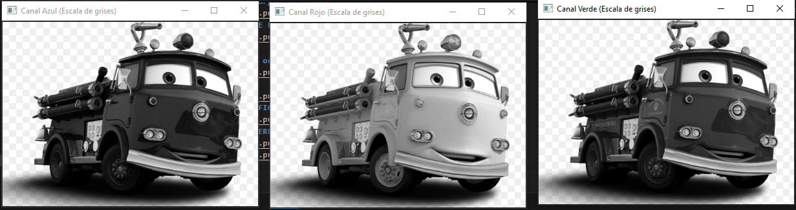
### coloreado
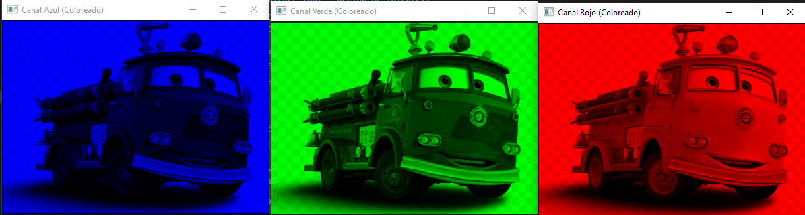

## 7. REDIMENSIONAMIENTO DE IMÁGENES (RESIZING)
### Redimensionada a 400x300
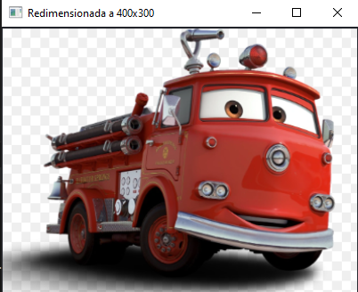
### Mitad de tamaño 
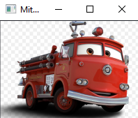
### Ampliada
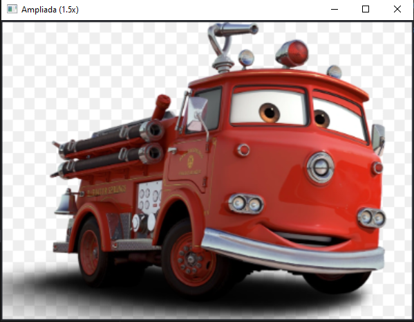
## 8. Rotacion de imagenes 
### Imagen Rotada (45 grados)
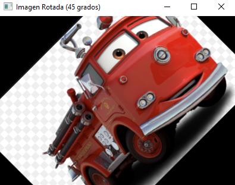
## 9. VOLTEO / ESPEJO DE IMÁGENES (FLIPPING)
### Volteo Horizontal (Espejo)
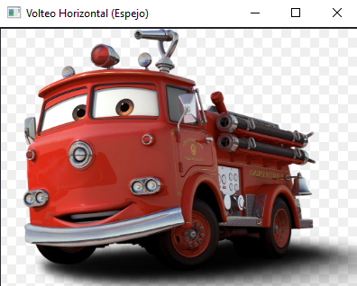
### Volteo Vertical (De cabeza)
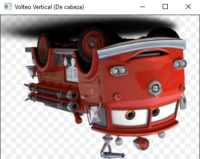
### Volteo en Ambos Ejes
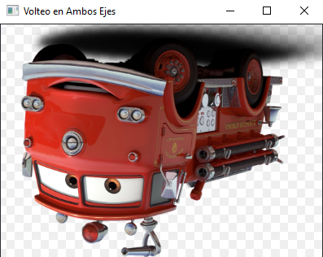
## 10. GUARDADO DE RESULTADOS Y LIMPIEZA
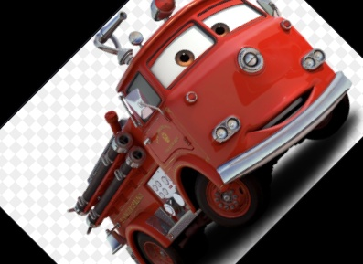
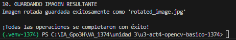